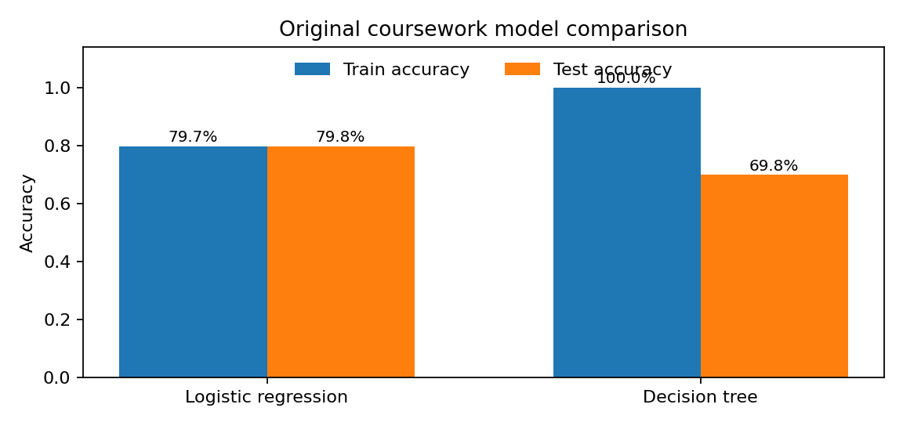

# Credit Card Default Prediction | Python Classification

**Python · Pandas · scikit-learn · Predictive analytics**

[**Full portfolio case study →**](https://chetna-1211.github.io/#case-credit) · [**View notebook →**](credit_card_default_analysis.ipynb)

## Business question

Can historical credit account attributes be used to identify patterns associated with next-month payment default? This academic analysis explored the question through data preparation and two classification approaches.

## Approach

- Inspected missing values and re-coded selected customer and repayment features.
- Used a stratified 70/30 train/test split on the first 4,000 eligible observations in the supplied course data.
- Compared **logistic regression** and an **unpruned decision tree**.
- Examined how train and test accuracy differed, highlighting the tree model's tendency to overfit in the original exercise.

## Original assignment results

| Model | Training accuracy | Test accuracy |
| --- | ---: | ---: |
| Logistic regression | 79.68% | **79.75%** |
| Decision tree | 100.00% | **69.83%** |

These figures are taken from the **original submitted notebook outputs**, not from a fresh execution of the public notebook. The public notebook reorganises preprocessing into scikit-learn pipelines to address potential data leakage; **new runs may produce different metrics**.

## Reproduce the analysis

1. Install dependencies from [`requirements.txt`](requirements.txt).
2. Obtain an appropriately licensed copy of the same course dataset and save it locally as `credit_card_defaults2.xlsx` next to the notebook.
3. Open [`credit_card_default_analysis.ipynb`](credit_card_default_analysis.ipynb) in Jupyter and run the cells from top to bottom.

**Dataset availability:** The university dataset is not redistributed in this repository. Without it, the notebook cannot be run directly.

## Takeaway

A higher training score does not guarantee better performance on unseen data. For credit decisions, class-specific recall, precision, calibration, fairness and the financial impact of false classifications also matter; accuracy alone is insufficient.

[Portfolio](https://chetna-1211.github.io/) · [LinkedIn](https://www.linkedin.com/in/chetnachoudhari/)
